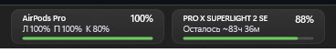

# BatteryInTaskBar

Виджет для панели задач Windows 11, который показывает заряд беспроводной мыши
и Bluetooth-наушников (AirPods / Beats) прямо рядом с треем.



## Возможности

- Заряд беспроводной мыши в отдельной плитке.
- Вторая плитка для AirPods / Beats: заряд левого, правого наушника и кейса.
- Перетаскивание плиток по панели задач; при наложении одной на другую они меняются местами.
- Плавное появление и скрытие плитки наушников.
- Темы «Матовая», «Тёмная», «Светлая» в стиле Windows 11.
- Кэш последних показаний: после перезапуска Explorer не появляется «Поиск устройства…».
- Отдельные меню у мыши и наушников: у мыши — «Закрыть виджет», у наушников — «Скрыть виджет».
- Диагностический отчёт по пяти кликам на названии устройства в меню мыши.
- Нет телеметрии, сетевых запросов и фоновых служб.

## Поддерживаемые устройства

| Устройства | Как читается заряд |
|---|---|
| Logitech (G / Pro, HID++) | HID++ 2.0 feature reports |
| Razer | vendor feature report `0x07` |
| Red Square / VXE / ATK / VGN | 17-байтный vendor-отчёт |
| Compx / Nordic (Attack Shark и др.) | vendor feature report |
| Большинство остальных мышей | стандартный HID Battery Strength (`0x06/0x20`) |
| Устройства, заряд которых знает Windows | PnP `PKEY_BatteryLevel` (HID/USB/BT) |
| AirPods / Beats | Apple BLE proximity-pairing (`0x07`) |

Если конкретная мышь не определилась — запустите `injector.exe --dump-hid`
и приложите отчёт к issue: в HID-дампе есть всё, что нужно для добавления
провайдера.

## Требования

- Windows 11 x64.
- Для сборки: Visual Studio 2022 (Desktop C++ workload) и Windows SDK 10.
  CMake 3.20+.

## Сборка

```powershell
cmake -S . -B build -G "Visual Studio 17 2022" -A x64
cmake --build build --config Release --parallel
```

Результат:

```
build\Release\taskbar_mod.dll
build\Release\injector.exe
```

## Запуск

```powershell
build\Release\injector.exe
```

Инжектор загружает `taskbar_mod.dll` в `explorer.exe`. DLL создаёт окна
поверх панели задач и запускает опрос. Права администратора не нужны
(Explorer работает с тем же уровнем целостности, что и пользователь).

`injector.exe --watch` поддерживает виджет живым после перезапуска Explorer.

`injector.exe --dump-hid` сохраняет HID-диагностику в
`%LOCALAPPDATA%\BatteryInTaskBar`.

Автозапуск включается галочкой «Запускать при старте системы» в меню мыши.

> SmartScreen может предупредить при первом запуске — это нормально.

## Данные

- Журнал и отчёты: `%LOCALAPPDATA%\BatteryInTaskBar`
- Настройки: `HKCU\Software\BatteryInTaskBar`
- Позиции плиток: `PosOffset` и `HeadsetPosOffset`

## Как это работает

DLL внедряется в Explorer и создаёт два небольших layered-окна над панелью
задач. Заряд берётся из HID feature/input-отчётов, PnP-свойств и BLE-рекламы.
Рисование — Direct2D / DirectWrite; отдельных процессов нет, UI Automation
в простое не дёргается.

Инструмент внедряет код в `explorer.exe`, поэтому некоторые антивирусы могут
считать его подозрительным. Исходный код открыт; инжектор намеренно маленький
и ничего не делает, кроме загрузки DLL.

## Лицензия

MIT. См. [LICENSE](LICENSE).

Неофициальный проект, не связан с Microsoft, Logitech, Razer, Apple или другими
производителями.
