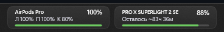

# BatteryInTaskBar

Виджет для панели задач Windows 11, который показывает заряд беспроводной мыши
и Bluetooth-наушников (AirPods / Beats) прямо рядом с треем.



## Возможности

- Заряд беспроводной мыши в отдельной плитке.
- Вторая плитка для AirPods / Beats: заряд левого, правого наушника и кейса.
- Перетаскивание плиток по панели задач; при наложении одной на другую они меняются местами.
- Плавное появление и скрытие плитки наушников.
- Темы «Матовая», «Тёмная», «Светлая» в стиле Windows 11.
- Кэш последних показаний: после перезапуска Explorer не появляется «Поиск устройства…».
- Если заряд не менялся больше суток (например, у Attack Shark X6 индикатор залипает на 100 %), рядом с процентом появляется «(?)», а в меню — пояснение.
- Проверка обновлений из меню мыши: `updater.exe` скачивает новый релиз с GitHub, сверяет SHA256 и заменяет DLL/инжектор с перезапуском виджета.
- Отдельные меню у мыши и наушников: у мыши — «Закрыть виджет», у наушников — «Скрыть виджет».
- Диагностический отчёт по пяти кликам на названии устройства в меню мыши.
- Нет телеметрии, сетевых запросов и фоновых служб.

## Поддерживаемые устройства

| Устройства | Как читается заряд |
|---|---|
| Logitech (G / Pro, HID++) | HID++ 2.0 feature reports |
| Razer | vendor feature report `0x07` |
| Red Square / VXE / ATK / VGN | 17-байтный vendor-отчёт |
| Attack Shark X6 / X11 / R1 / X3 / M3, Inphic (Beken `1d57:fa60` донгл / `fa61` кабель / `fa65`) | interrupt-IN `03 <модель> 40 …` на коллекции `0x000A:0x0000` |
| Compx / Nordic (Attack Shark и др.) | vendor feature report |
| Большинство остальных мышей | стандартный HID Battery Strength (`0x06/0x20`) |
| Устройства, заряд которых знает Windows | PnP `PKEY_BatteryLevel` (HID/USB/BT) |
| AirPods / Beats | Apple BLE proximity-pairing (`0x07`) |

Если конкретная мышь не определилась — запустите `injector.exe --dump-hid`
и приложите отчёт к issue: в HID-дампе есть всё, что нужно для добавления
провайдера.

## Требования

- Windows 11 x64.
- Для сборки: Visual Studio 2022 (Desktop C++ workload) и Windows SDK 10.
  CMake 3.20+.

## Сборка

```powershell
cmake -S . -B build -G "Visual Studio 17 2022" -A x64
cmake --build build --config Release --parallel
```

Результат:

```
build\Release\taskbar_mod.dll
build\Release\injector.exe
build\Release\updater.exe
```

## Запуск

```powershell
build\Release\injector.exe
```

Инжектор загружает `taskbar_mod.dll` в `explorer.exe`. DLL создаёт окна
поверх панели задач и запускает опрос. Права администратора не нужны
(Explorer работает с тем же уровнем целостности, что и пользователь).

`injector.exe --watch` поддерживает виджет живым после перезапуска Explorer.

`injector.exe --dump-hid` сохраняет HID-диагностику в
`%LOCALAPPDATA%\BatteryInTaskBar`.

## Обновление

При запуске виджет сам проверяет GitHub — без окон и без участия пользователя.
Внизу меню мыши есть строка **«Версия: 1.0.7»** и две маленькие кнопки справа:

- **↻** — проверить обновления прямо сейчас;
- **↑** — установить найденную версию. Если обновление есть, на кнопке
  появляется синяя точка; если нет — точка не показывается.

Пока идёт проверка, в футере видно «Проверка…», затем результат:
«Обновление 1.0.8», «Обновлений нет» или «Ошибка проверки». Через несколько
секунд снова показывается версия. Проверка и установка идут отдельными
процессами `updater.exe`, поэтому интерфейс виджета не блокируется.

Само обновление проходит в тихом режиме: `updater.exe` (лежит рядом с DLL)
скачивает `taskbar_mod.dll`, `injector.exe` и `SHA256SUMS.txt`, сверяет
SHA256, останавливает сторож, закрывает и выгружает виджет, заменяет файлы
с `.bak`-копиями и запускает новый `injector.exe --watch`. Окна обновлятора
пользователь не видит.

Живой процент в кабельном режиме по-прежнему недоступен, но обновление
работает и для него.

Ограничения: папка программы должна быть записываемой (не `Program Files`),
а бинарники пока без подписи — SmartScreen может предупреждать. Первую
версию с обновлятором нужно поставить вручную; дальше обновления идут из
меню. Журнал обновлятора: `%LOCALAPPDATA%\BatteryInTaskBar\updater.log`.

Автозапуск включается галочкой «Запускать при старте» в меню мыши.

> SmartScreen может предупредить при первом запуске — это нормально.

## Данные

- Журнал и отчёты: `%LOCALAPPDATA%\BatteryInTaskBar`
- Настройки: `HKCU\Software\BatteryInTaskBar`
- Позиции плиток: `PosOffset` и `HeadsetPosOffset`

## Как это работает

DLL внедряется в Explorer и создаёт два небольших layered-окна над панелью
задач. Заряд берётся из HID feature/input-отчётов, PnP-свойств и BLE-рекламы.
Рисование — Direct2D / DirectWrite; отдельных процессов нет, UI Automation
в простое не дёргается.

Инструмент внедряет код в `explorer.exe`, поэтому некоторые антивирусы могут
считать его подозрительным. Исходный код открыт; инжектор намеренно маленький
и ничего не делает, кроме загрузки DLL.

## Лицензия

MIT. См. [LICENSE](LICENSE).

Неофициальный проект, не связан с Microsoft, Logitech, Razer, Apple или другими
производителями.
